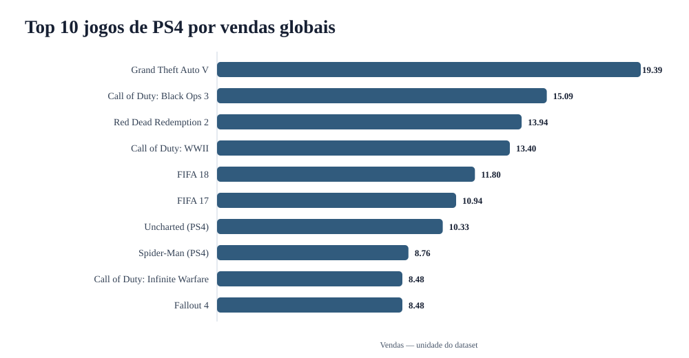
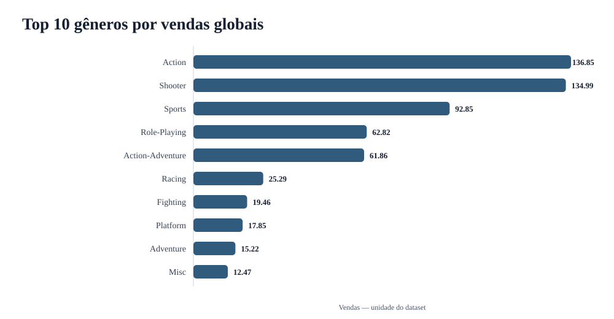
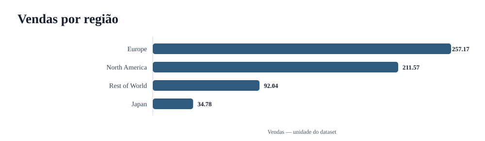
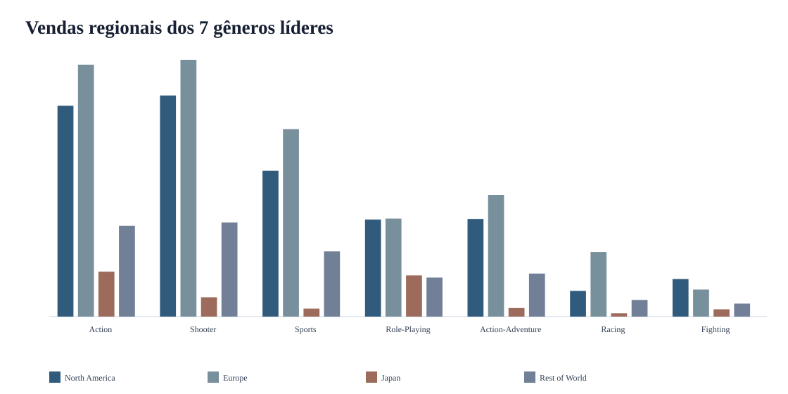
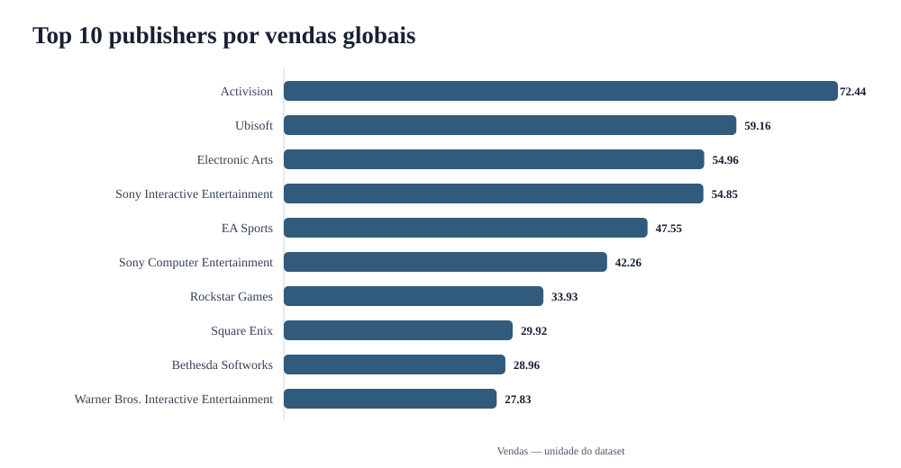
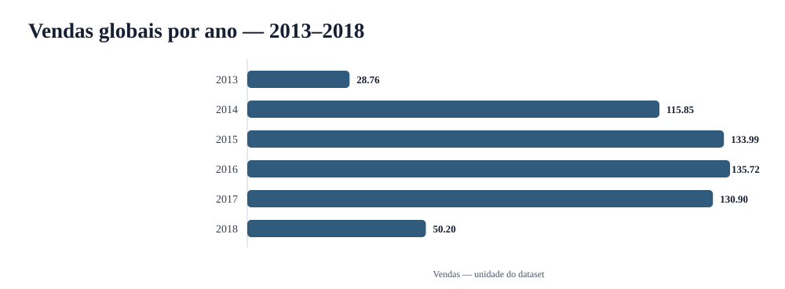
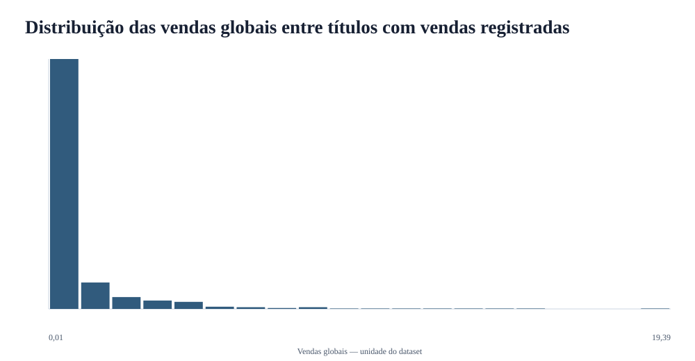

# PS4 Game Sales — Análise Exploratória com Python

Projeto de portfólio em **Análise de Dados com Python** que investiga vendas de jogos para PlayStation 4 por título, gênero, publisher, região e período.

## Pergunta central

**Como as vendas de jogos de PS4 se distribuem por título, gênero, publisher, região e período?**

O projeto combina análise exploratória, qualidade dos dados, visualização e interpretação de mercado sem alterar silenciosamente as inconsistências presentes na fonte.

## Dataset

A base contém:

- **1.034 registros**
- **1.031 jogos únicos**
- **17 gêneros**
- **152 publishers identificados**
- anos registrados entre **2013 e 2020**
- vendas globais somadas de **595,64 unidades do dataset**

> O arquivo não traz, por si só, um dicionário formal com a unidade das vendas. Por isso, os gráficos e textos usam a expressão **“unidade do dataset”**.

## Qualidade dos dados

- **209 registros** sem ano;
- **209 registros** sem publisher;
- **322 registros** com venda global igual a zero;
- **0 duplicatas completas**;
- **3 nomes de jogos repetidos** com metadados diferentes.

A metodologia completa está em [reports/data_quality.md](reports/data_quality.md).

## 1. Jogos líderes

**Grand Theft Auto V** lidera a base com **19,39 unidades do dataset** em vendas globais.

## 2. Gêneros

**Action** apresenta o maior volume total de vendas, com **136,85**, seguido de **Shooter**, com **134,99**.

Volume total e média por título contam histórias diferentes. Action lidera em volume, enquanto Action-Adventure e Shooter apresentam médias por jogo superiores entre os principais gêneros.

## 3. Distribuição regional

A **Europa** concentra aproximadamente **43,18%** das vendas regionais somadas, seguida da **América do Norte**, com **35,52%**.

| Região | Participação |
|---|---:|
| Europa | 43,18% |
| América do Norte | 35,52% |
| Restante do mundo | 15,45% |
| Japão | 5,84% |

## 4. Gêneros e diferenças regionais

Na América do Norte e Europa, Shooter, Action e Sports concentram grande volume. No Japão, Action e Role-Playing ganham maior peso relativo.

## 5. Publishers

Mantendo os rótulos exatamente como aparecem na fonte, **Activision** lidera as vendas globais, com **72,44**.

O projeto não consolida automaticamente nomes relacionados, como Electronic Arts e EA Sports, sem documentação adicional.

## 6. Evolução anual

A análise temporal principal utiliza **2013–2018**.

Os registros de 2019 e 2020 são preservados, mas não entram na interpretação principal de tendência porque todos os registros desses anos possuem venda global igual a zero na base fornecida.

## 7. Distribuição das vendas por título

A distribuição é fortemente assimétrica: poucos títulos concentram vendas muito superiores à maioria dos jogos.

## Principais achados

1. **Grand Theft Auto V** lidera as vendas globais registradas.
2. **Action** é o gênero com maior volume total.
3. **Europa** é a maior região da base em vendas somadas.
4. Shooter, Action e Sports são especialmente relevantes na América do Norte e Europa.
5. Role-Playing ganha mais importância relativa no Japão.
6. **Activision** lidera os publishers mantendo os rótulos originais.
7. A qualidade dos dados exige cautela na análise temporal.

## Estrutura do projeto

~~~text
ps4-game-sales-data-analysis/
├── .github/workflows/python-tests.yml
├── data/
│   ├── raw/ps4_games_sales.csv
│   └── README.md
├── notebooks/ps4_game_sales_analysis.ipynb
├── reports/
│   ├── figures/
│   ├── data_quality.md
│   └── summary.json
├── src/
│   ├── analysis.py
│   └── data_cleaning.py
├── tests/test_data_cleaning.py
├── pytest.ini
├── requirements.txt
├── LICENSE
└── README.md
~~~

## Como executar

~~~bash
python -m venv .venv
pip install -r requirements.txt
python -m src.analysis
~~~

Para abrir o notebook: notebooks/ps4_game_sales_analysis.ipynb

## Testes

~~~bash
pytest -q
~~~

## Tecnologias

- Python
- Pandas
- NumPy
- Matplotlib
- Jupyter Notebook
- Pytest
- GitHub Actions

## Limitações

- 209 registros não possuem ano nem publisher;
- 322 registros possuem venda global zero;
- 2019 e 2020 não são usados para inferir tendência;
- não há preço, receita, avaliação de usuários ou custos de desenvolvimento;
- a análise descreve apenas o dataset fornecido.

## Autor

**Pablo Sena**

GitHub: [@pablosena28](https://github.com/pablosena28)